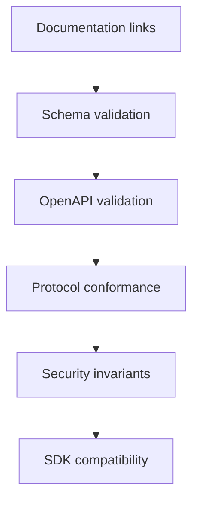

# Tests

AIFP tests should prove protocol conformance, schema correctness, security invariants, and documentation integrity.

## Test Layers



## Required Test Categories

| Category | What It Protects |
|---|---|
| Receipt verification | Signature, issuer, audience, resource, amount, expiry, nonce |
| Replay protection | Reused nonce rejected with conflict |
| Idempotency | `/pay` does not double-charge |
| Error registry | Stable protocol errors |
| OpenAPI | Request/response compatibility |
| JSON Schemas | Object shape compatibility |
| Docs links | Discoverability and public-release quality |

## Draft Merchant Fee Conformance

These checks cover the proposed merchant fee profile from PR #10. They do not
activate that profile or change the fixed-rate baseline or AIFP-2 economics.

```bash
python3 scripts/check-merchant-fee-profile.py
python3 -m venv .venv-conformance
.venv-conformance/bin/python -m pip install --only-binary=:all: -r scripts/requirements-conformance.txt
.venv-conformance/bin/python scripts/check-merchant-fee-schema.py
```

The arithmetic checker validates all published valid and invalid vectors with
exact integers. The schema suite uses `jsonschema==4.26.0` and its Draft 2020-12
validator to check the draft schema, required bindings, valid envelopes, unknown
fields, profile isolation, integer bounds and canonical atomic amount strings.
The dependency version is published on [PyPI](https://pypi.org/project/jsonschema/4.26.0/).

Schema validation checks structure. Cross-field conservation, immutable quote
binding, ownership, authorization and actual atomic settlement require separate
implementation checks. The suite explicitly demonstrates this distinction.
Hosted CI runs both draft checks after the existing baseline and lifecycle checks;
dependency-install errors and test failures remain blocking.
